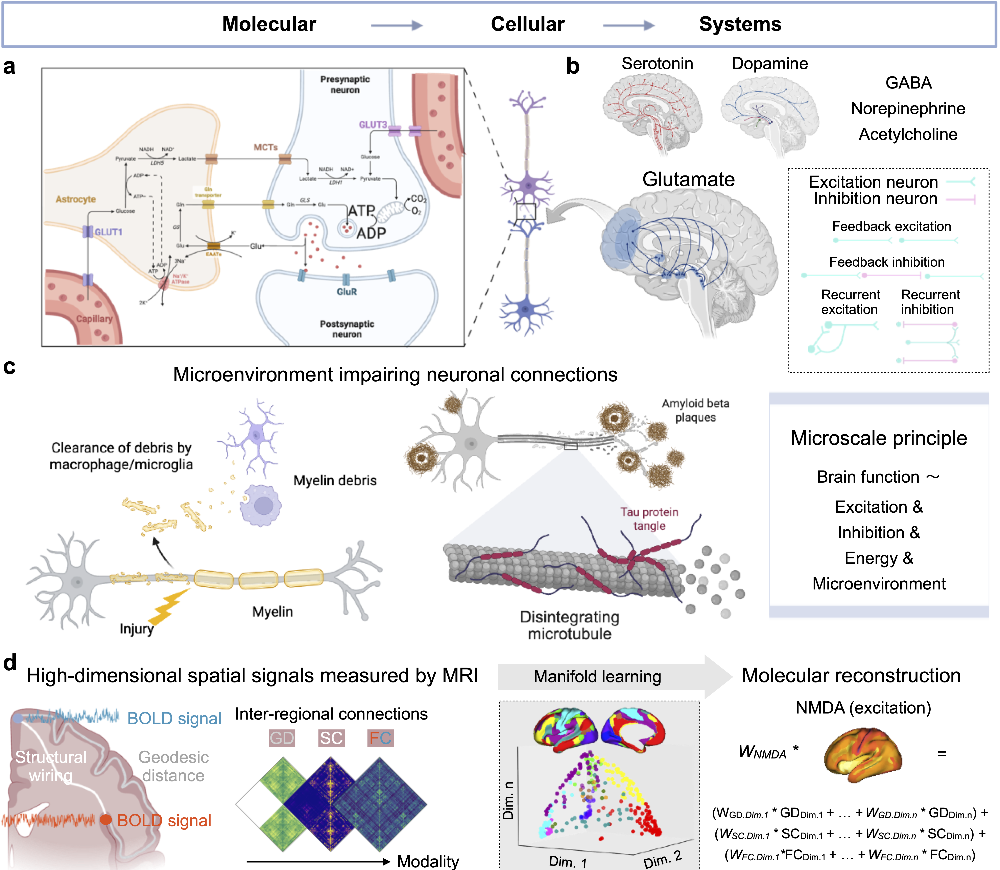

# EigenBrain maps cortical molecular architecture from geometric, structural, and functional eigenmodes

**Bin Wan et al.**
Preprint: https://www.biorxiv.org/content/10.1101/2024.09.26.615152v1

## Data Sources
Raw data can be downloaded from

- HCP (https://www.humanconnectome.org/) unrelated subject list
- Neuromaps (https://github.com/netneurolab/neuromaps)
- OpenNeuro (https://openneuro.org/datasets/)
  - Energy Cost Munich
  - Dallas Lifespan

Data have been processed by the scripts below. See directory "./scripts/python/"

- T1w and DWI preprocessed by MICApipe, fMRI clean surface data
- py01_hcp_connectome.py -> geodesic/structural/functional connectivity matrix
- py02_hcp_eigen_process.py -> diffusion map embedding MRI eigenmodes using BrainSpace
- py03_neuromaps_process.py -> GLM to fit neurotransmitter maps using these MRI eigenmodes
- py04_autism_eigen_process.py -> subjects in ABIDE (cross-sectional autism) and calculate individual eigenmodes aligned to HCP group level
- py05_scz_eigen_process.py -> subjects in SYMONE (longitudinal schizophrenia) and calculate individual eigenmodes aligned to HCP group level
- py06_CMRglc_eigen_process.py -> subjects in Energy Cost Munich and calculate individual eigenmodes aligned to HCP group level
- py06_CMRglc_modeling.py -> fit CMRglc map using HCP eigenmodes and/or individual self eigenmodes
- py07_dallas -> the same to the CMRglc for tau and amyloid
- py08_nulls.py -> generating spatial null maps based on the variogram for all the markers

Templates, modeling results, and parameters have been saved in "./results/"

- ./reseults/hcp -> hcp group-level eigenmodes and GLM parameters for each neurotransmitter using each MRI modality
- ./reseults/neuromaps -> neurotransmitter maps and performance convergence of each model
  
**P.S.** Users can use the files in "./reseults/hcp" to predict their own disease maps. We will later develop a tool EigenBrain_toolbox to help generate the individual neurotransmitter maps with new features (deep learning on the individual molecular imaging).

**Don't hesitate to contact me (binwan[dot]academic[at]gmail.com) if you need any help when translating your maps**

## Fundings 

- Bin Wan: Novartis Foundation for Medical-Biological Research (No. 26B040)
- Matthias Kirschner: Swiss National Science Foundation (No. 32003B_219240)
